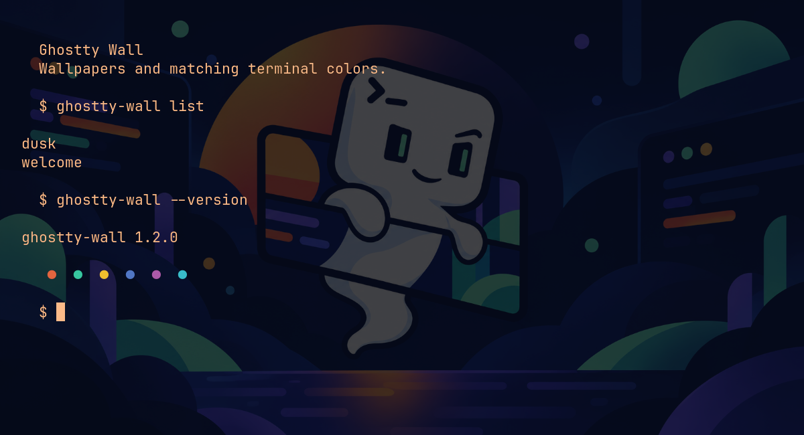
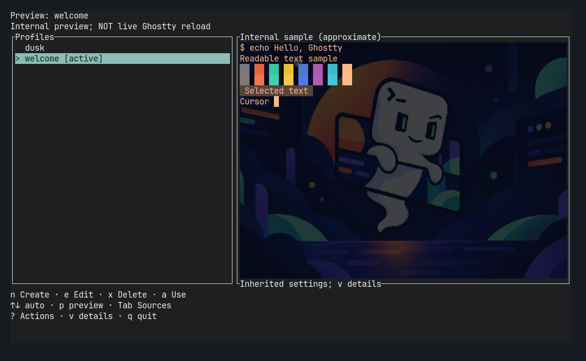

# Ghostty Wall

Set a Ghostty wallpaper, generate matching terminal colors, and save looks you can switch between.



*Real Ghostty window using the bundled `welcome` profile.*



*Profile browser running in Ghostty. Internal preview, not live Ghostty reload.*

## Install — Linux x86_64

Requires Ghostty, Bash, curl, tar and sha256sum. No Rust toolchain needed.

[Inspect the installer](scripts/install-release.sh) before running it:

```bash
curl -fsSL https://raw.githubusercontent.com/GiovanniCaiazzo01/Ghostty-wall/main/scripts/install-release.sh | bash
```

Installs the latest stable release into `~/.local/bin` and verifies its SHA-256 checksum. Make sure that directory is on your PATH. [Installation help and PATH conflicts](https://giovannicaiazzo01.github.io/Ghostty-wall/installation/).

Linux x86_64 is supported. macOS is experimental with no supported installer; other Linux architectures have no supported installer. Windows is unsupported. The curl installer is the supported installation route.

## Quick start

```bash
ghostty-wall init
ghostty-wall apply welcome
ghostty-wall create
```

The first two commands try the bundled wallpaper. `create` generates a wallpaper or imports your PNG/JPEG, then saves and optionally uses it. If Ghostty does not change, reload its configuration manually.

Run `ghostty-wall` to browse saved looks. **Use** applies the reviewed result; changed inputs require another preview. In Create/Edit:

- `s`: **Save** without applying.
- `u`: **Save and use**, with confirmation.
- Esc/`q`: **Cancel** unpublished changes.
- `p`: switch Controls / Preview in compact editors; `v`: preview details.

## What's new in 1.4

- Responsive browsing and asynchronous previews; Use keeps full validation.
- Varied generated wallpapers, reversible image blur and adjustable darkening.
- Preview-led layouts with contextual Wallpaper / Colors / Terminal controls.
- Role-aware `oklch-v2` colors. Infeasible contrast is warned: fallback is **not valid 4.5:1**.

Original images, customized colors and History remain intact; existing algorithms are not migrated. [Effects and compatibility](docs/advanced-usage.md#reversible-image-blur-and-darkening).

These are approximate internal previews, not live Ghostty reload. Unsupported graphics use labelled cell fallback. Ghostty's own opacity, wallpaper and compositor settings remain untouched. [Readability limits](docs/advanced-usage.md#readability).

[Short browser walkthrough](media/screenshots/profile-browser.gif): real Ghostty captures, earlier layout; not live wallpaper switching.

## Useful commands

```bash
ghostty-wall edit           # Customize a saved look
ghostty-wall source list    # Inspect configured wallpaper sources
ghostty-wall previous       # Restore the previous look
ghostty-wall update         # Update Ghostty Wall, not Ghostty
ghostty-wall uninstall      # Remove integration; keep profiles and history
```

## Documentation

- [Quick start](https://giovannicaiazzo01.github.io/Ghostty-wall/quick-start/)
- [User guides and command reference](https://giovannicaiazzo01.github.io/Ghostty-wall/)
- [Troubleshooting and recovery](https://giovannicaiazzo01.github.io/Ghostty-wall/troubleshooting/)
- [Source maintenance: show, edit, check and safe removal](https://giovannicaiazzo01.github.io/Ghostty-wall/wallpapers/#maintenance)
- [Advanced behavior and safety notes](docs/advanced-usage.md)
- [Changelog](CHANGELOG.md)

## Contributing

See [CONTRIBUTING.md](CONTRIBUTING.md) for branch conventions, PR descriptions and development checks. Pick a task from the [release plan and roadmap](https://github.com/GiovanniCaiazzo01/Ghostty-wall/issues/7), or open an issue to discuss a larger change.

MIT — see [LICENSE](LICENSE).
