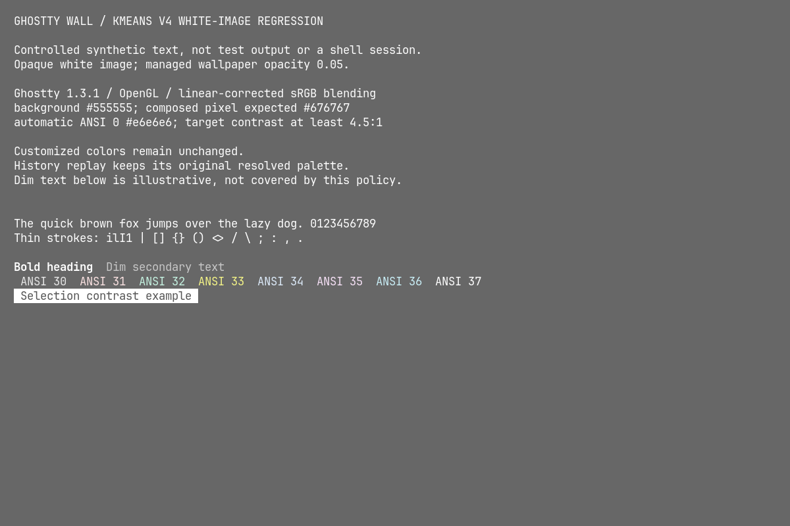
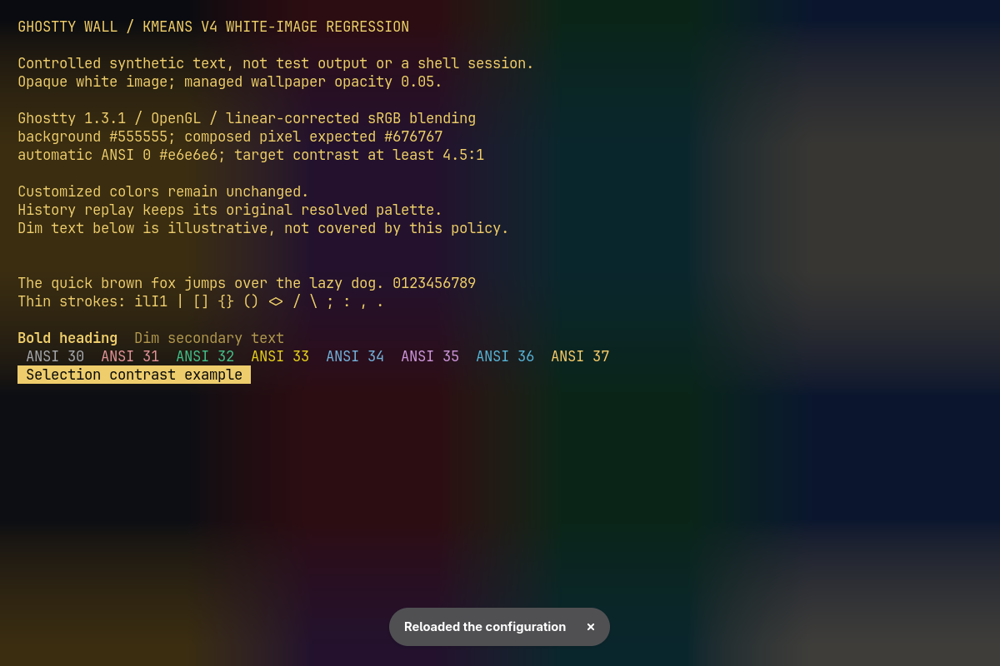
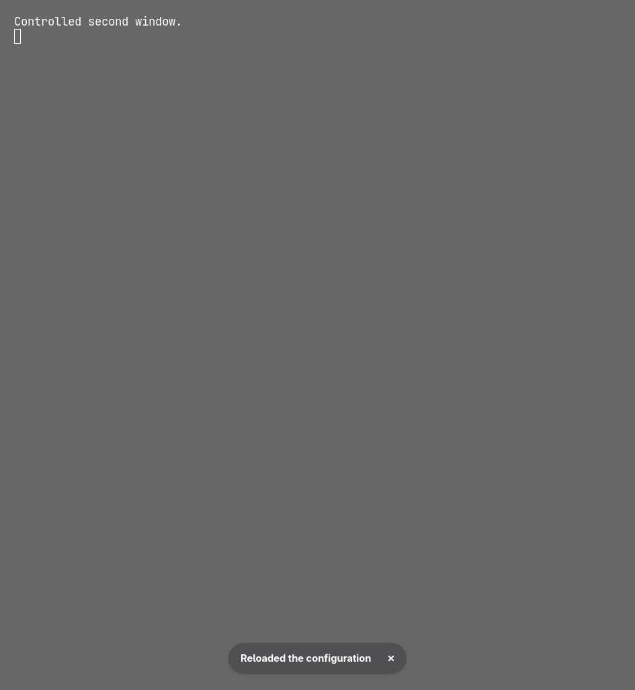

# v1.3.0 validation record

Release coordination: [#7](https://github.com/GiovanniCaiazzo01/Ghostty-wall/issues/7). Integrated validation: [#11](https://github.com/GiovanniCaiazzo01/Ghostty-wall/issues/11).

## Candidate identity

- Runtime integration base: `507ea0bb205b35b1d2510253e6a4280394824133`, containing merged PRs [#13](https://github.com/GiovanniCaiazzo01/Ghostty-wall/pull/13), [#15](https://github.com/GiovanniCaiazzo01/Ghostty-wall/pull/15), [#16](https://github.com/GiovanniCaiazzo01/Ghostty-wall/pull/16) and [#17](https://github.com/GiovanniCaiazzo01/Ghostty-wall/pull/17).
- Release-preparation changes: package/lockfile version **1.3.0**, release documentation/screenshots and a test-harness-only BrokenPipe fix. No runtime code changes after the integration base.
- Local locked release binary: `ghostty-wall 1.3.0`; SHA-256 `4114b3c93ed790c8ff92e955554cbf8aa60f7a3a6ed3edcc9089035f7a08002c`.
- Locally packaged Linux archive: SHA-256 `cdaceb76833dea654afdba0ace4e6279283a16253610ee852f2f72bddbe461f0`. Both versioned and stable-alias checksums verified. This archive is **not** the GitHub-built published artifact.
- Host: Linux `6.18.55-2-cachyos-lts`, x86_64 GNU/Linux. Real renderer: Ghostty `1.3.1-arch2.2`, OpenGL, Hyprland/Wayland. Observations recorded 2026-10-23 UTC.

The release PR identifies the exact preparation commit; the published tag identifies the final source. Official workflow builds have a different binary identity and must be checked separately after download. Publication status and final artifact evidence are recorded in #11, not inferred from local tests.

## Automated and installed-product checks

| Check | Evidence |
| --- | --- |
| Formatting and all-target/all-feature Clippy | Pass on versioned candidate; warnings denied. |
| Rust tests | Clean locked all-target/all-feature run: **339 passed, 3 intentionally ignored** before the harness-only fix below. Final exact-head CI repeats the complete suite, including its added regression. |
| Release-binary PTYs | **113 passed**, including fixed/random reviewed identity, changed input while awaiting lock, failed/loading preview rejection, Save / Save and use / Cancel, Source maintenance and Previous. |
| Legacy Bash and release installer | Both suites pass. ShellCheck is unavailable locally; GitHub CI runs it. |
| Documentation | Generator/site checks and tracked generated output checked in the release PR. |
| Installed local archive | Checksums, `install.sh`, installed `--version`, `init`, `doctor`, own-image guided Save without activation, cancelled creation, Apply, Previous, Save then Use now, Source show/edit/check/remove all pass in disposable HOME. Four expected Activations; root user configuration and original images unchanged. |
| Compatibility | Exact v1–v3 palette fixtures, old generated provenance, Profile versions 1/2, customized slots, original images and source-independent History replay covered by existing/focused regressions. |

Commands used for the corresponding gates:

```sh
cargo fmt --check
cargo clippy --locked --all-targets --all-features -- -D warnings
cargo test --locked --all-targets --all-features
cargo build --locked --release
GHOSTTY_WALL_BIN="$PWD/target/release/ghostty-wall" \
  python3 -B -m unittest discover -s tests -p '*pty.py' -v
bash scripts/test.sh
bash scripts/test-install-release.sh
python3 website/generate.py
python3 website/test_site.py
git diff --exit-code -- website/dist
```

An initial 600-second Rust run timed out after completed suites; a subsequent complete run passed. Main CI also exposed a pre-existing test race: a correctly rejected CLI command can close stdin before its test writes confirmation. The harness now tolerates **only BrokenPipe**, still checking the child's actual status/output. A >pipe-capacity `--version` regression reproduced that exact failure before the fix and passes afterward. This changes tests, not product input handling.

## Real Ghostty: readability

Only owned windows were captured: exact Ghostty PID/executable, application ID/title and foreign-toplevel identity were checked before each `grim -T` capture. No whole-desktop captures, global input injection or personal configuration changes were used. Text is controlled synthetic content, not claimed test output.

Settings: linear-corrected sRGB blending, terminal opacity 1, no blur, PNG image alpha 1, cover/center/no-repeat, wallpaper opacity **0.05**, `minimum-contrast=1` to disable external contrast correction. The source is `tests/fixtures/white.png`; the applied v4 background is `#555555` and automatic ANSI 0 is `#e6e6e6`.

- Model background luminance: **0.1362996256**, encoding to RGB **103.239** per channel.
- Observed background at `(1100,700)` in the 1200×800 capture: **(103,103,103)**.
- ANSI 0: **4.5158:1** against modeled background; **4.5320:1** against observed background. Exact `#e6e6e6` glyph pixels were present.
- Before the fix, the same default-opacity model counterexample was **3.404:1**. The white-image regression now requires every automatic ANSI slot, foreground and cursor to meet the declared 4.5:1 model target.



Screenshot SHA-256: `7e4b1b7ee4da153fe391b88578e0ce9f98e0a7b96503f1abfd2699602727dae4`.

## Real Ghostty: reload observations

A disposable HOME and private `dbus-run-session` isolated all reload actions. The successful route launched Ghostty without custom CLI flags, reading its disposable default configuration with `gtk-single-instance=true` and the managed optional integration hook. `GTK_A11Y=none` avoided unrelated accessibility-service startup in this isolated session. The private systemd user service was unavailable; the adapter used the real GTK D-Bus `reload-config` action.

| Observation | Adapter result | Independent visible evidence |
| --- | --- | --- |
| Apply dark Profile, one window | Succeeded; reload requested | At `(1100,700)`, background changed **(103,103,103) → (45,46,52)**. Wallpaper/text colors visibly changed. |
| Open second window in same Ghostty process | Real GTK `new-window` action | Both windows verified against the same owned PID; second window initially dark. |
| Apply white Profile, two windows | Succeeded; reload requested | First window returned to **(103,103,103)**. Second changed **(11,22,46) → (103,103,103)** at `(943,700)` in its 945×1025 capture. Both displayed Ghostty's reload notification. |
| Direct custom-config launch | Unavailable; manual reload requested | That owned process did not own the expected well-known D-Bus name. Committed state was retained; no visible automatic change was claimed. |
| Failed reload | Automated adapter/PTY fixtures only | Failure is reported after commit; no claim of real-window failure-path visual proof. |





The first screenshot's controlled text remains static when the Profile changes; its printed white-case RGB labels do not describe the later dark background. Pixel measurements and the actual rendered result are recorded separately above.

## Limits and release decision

- Real systemd user-service launch was unavailable in the private session; that route has automated adapter coverage, not new real-service visual proof. Native blending, Display P3, external overrides, desktop transparency and macOS were not verified.
- Conservative whole-image correction can include cropped-out highlights. Customized backgrounds can invalidate automatic bounds. At high image opacity even white text can miss 4.5:1. Faint/dim text, application-specific colors, cursor text and inherited settings are not certified. Samples report estimates, not universal accessibility.
- A separate unfamiliar human was unavailable for the first-use walkthrough. Automated installed-product and PTY paths are not represented as human usability evidence.
- Full-screen reviewed-result identity covers managed content, not pixel-perfect effective rendering. Standalone CLI apply keeps its normal resolution behavior; the legacy nonterminal line browser is not the reviewed full-screen sample.
- Local candidate validation supports release preparation. **Publish only after release PR/main CI and official artifact gates pass.** A published asset is not validated merely because this local binary passed. #11 records the final ready/not-ready decision and downloaded-artifact verification.
